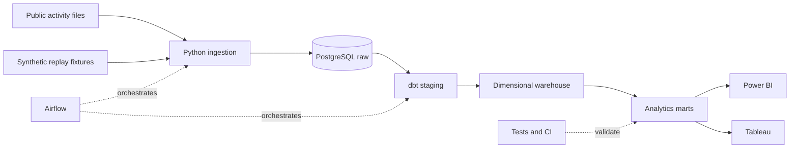

# Telecom Network Activity Analytics Platform

A six-weekend data engineering portfolio project that will transform historical telecom activity into reliable analytics for Power BI and Tableau. The current implementation loads synthetic test batches and a checksum-verified sample of the public dataset into a local PostgreSQL raw layer. dbt models, orchestration, and dashboards are planned.

## Business questions

- How does internet, call, and SMS activity vary by time and geographic grid?
- Which grids have the greatest activity and which show unusual changes?
- How do weekday and weekend activity patterns differ?
- Are incoming batches complete and valid enough for reporting?

The planned public source is the [Telecom Italia Milan dataset](https://doi.org/10.7910/DVN/EGZHFV). Its records describe historical activity from 2013, aggregated over geographic grid squares and time intervals. The [dataset publication](https://www.nature.com/articles/sdata201555) describes activity values as proportional measures: do not label them as gigabytes, subscriber counts, physical cell KPIs, or current operational measurements.

**Data access:** The dataset's custom terms identify the [ODbL 1.0](https://opendatacommons.org/licenses/odbl/1-0/) and require attribution, including [from BigDataChallenge contest](https://theodi.fbk.eu/openbigdata/). Review the dataset and grid-reference terms when sharing derived data or dashboards. Harvard Dataverse requires a guestbook response to download the original file. No public-source data is included in this repository. The synthetic fixtures below contain invented values and are not public-source observations.

## Planned architecture



The synthetic replay fixtures will be used in isolated test runs, not blended into reports of public data. See [the six-weekend plan](docs/roadmap.md), [Git workflow](docs/git-workflow.md), [architecture decisions](docs/architecture.md), and [source contract](docs/data_contract.md).

## Run the synthetic fixture generator

Python 3.12 is available on the development machine. The generator uses only the Python standard library.

```powershell
cd telecom-network-activity-platform
python scripts/generate_fixture.py --output-dir data/generated/fixture
python -m unittest discover -s tests -p test_generate_fixture.py -v
```

The generator refuses to overwrite any existing fixture file. To generate another copy, choose a new output directory. Generated data is ignored by Git. It consists of a baseline batch, a late-arrival batch, a correction batch, and a manifest describing the deliberately injected errors.

## Run the raw ingestion layer locally

Prerequisites: Docker Desktop with Compose, Python 3.12, and port 5432 available on localhost. The first initialization creates a project-specific PostgreSQL volume; the SQL initialization scripts run only when that volume is first created.

```powershell
python -m venv .venv
.\.venv\Scripts\python.exe -m pip install -r requirements.txt
Copy-Item .env.example .env
# Edit .env and replace POSTGRES_PASSWORD with a unique local development password.
docker compose up -d --wait
# Generate the fixture if you have not already done so.
if (-not (Test-Path 'data/generated/fixture/manifest.json')) { python scripts/generate_fixture.py --output-dir data/generated/fixture }

$env:PGHOST = '127.0.0.1'
$env:PGPORT = '5432'
$env:PGDATABASE = 'telecom_warehouse'
$env:PGUSER = 'telecom'
$env:PGPASSWORD = (Get-Content .env | Where-Object { $_ -like 'POSTGRES_PASSWORD=*' } | Select-Object -First 1).Substring('POSTGRES_PASSWORD='.Length)
.\.venv\Scripts\python.exe -m ingestion.load_activity data/generated/fixture/baseline.tsv --source-system synthetic
.\.venv\Scripts\python.exe -m ingestion.load_activity data/generated/fixture/late.tsv --source-system synthetic
.\.venv\Scripts\python.exe -m ingestion.load_activity data/generated/fixture/correction.tsv --source-system synthetic

# Opt in to integration tests against the project database.
$env:RUN_DB_TESTS = '1'
.\.venv\Scripts\python.exe -m unittest discover -s tests -v
```

If you change the database name, user, or host port in `.env`, use matching `PGDATABASE`, `PGUSER`, and `PGPORT` values above. Do not commit `.env`. Use `docker compose stop` when finished; stopping preserves the database volume.

Ingestion hashes each file, logs batch counts, and stores accepted fields and rejects separately. Replaying the same bytes for the same source returns `already_loaded`. Accepted duplicates and corrections remain in raw data for the later dbt deduplication step. A malformed CSV stream rolls the batch back and records a failure when the database is available. Blank measures remain blank pending confirmation of the public-source semantics.

### Ingest a real-data sample

Download `sms-call-internet-mi-2013-11-01.txt` from [Harvard Dataverse](https://doi.org/10.7910/DVN/EGZHFV) after completing its guestbook, and place it in `data/raw/`. The original is about 308 MiB. The command below verifies the publisher's MD5 against the **entire original file**, records source and sample SHA-256 values in an ignored provenance file, and takes the first 50,000 lines. This convenience sample is ordered and is **not representative** of the whole dataset.

```powershell
.\.venv\Scripts\python.exe scripts/create_sample.py data/raw/sms-call-internet-mi-2013-11-01.txt data/raw/milan-2013-11-01-first-50000.tsv --expected-md5 658c49f8e3c7910bd3bb2bafbf62cdce --rows 50000
.\.venv\Scripts\python.exe -m ingestion.load_activity data/raw/milan-2013-11-01-first-50000.tsv --source-system telecom_italia_milan
```

Set the PostgreSQL environment variables from the preceding section first. Source files, samples, and their provenance files are ignored by Git. Do not publish a dataset-derived file without applying the dataset terms.

## Milestone status

| Stage | Status |
|---|---|
| 1. Scope, source design, and synthetic fixtures | Complete; public-source terms and file inspection pending |
| 2. Ingestion and PostgreSQL raw layer | Complete for a 50,000-row real-data sample and synthetic replay tests |
| 3. dbt staging and dimensional models | Planned |
| 4. Incremental loading, marts, and Airflow | Planned |
| 5. Power BI and Tableau | Planned |
| 6. CI and portfolio documentation | Planned |

PostgreSQL is configured in Compose. Airflow has not yet been configured. See the roadmap for acceptance criteria.

