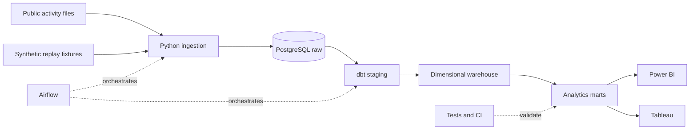

# Telecom Network Activity Analytics Platform

A six-weekend data engineering portfolio project that will transform historical telecom activity into reliable analytics for Power BI and Tableau. The current milestone establishes the design and provides reproducible synthetic test batches; the pipeline and dashboards are not implemented yet.

## Business questions

- How does internet, call, and SMS activity vary by time and geographic grid?
- Which grids have the greatest activity and which show unusual changes?
- How do weekday and weekend activity patterns differ?
- Are incoming batches complete and valid enough for reporting?

The planned public source is the [Telecom Italia Milan dataset](https://doi.org/10.7910/DVN/EGZHFV). Its records describe historical activity from 2013, aggregated over geographic grid squares and time intervals. The [dataset publication](https://www.nature.com/articles/sdata201555) describes activity values as proportional measures: do not label them as gigabytes, subscriber counts, physical cell KPIs, or current operational measurements.

**Data access:** The Dataverse entry lists custom terms. Review the dataset and grid-reference terms before downloading, redistributing, or publishing extracts. No public-source data is included in this repository. The synthetic fixtures below contain invented values and are not public-source observations.

## Planned architecture



The synthetic replay fixtures will be used in isolated test runs, not blended into reports of public data. See [the six-weekend plan](docs/roadmap.md), [architecture decisions](docs/architecture.md), and [source contract](docs/data_contract.md).

## Run the synthetic fixture generator

Python 3.12 is available on the development machine. The generator uses only the Python standard library.

```powershell
cd telecom-network-activity-platform
python scripts/generate_fixture.py --output-dir data/generated/fixture
python -m unittest discover -s tests -v
```

The generator refuses to overwrite any existing fixture file. To generate another copy, choose a new output directory. Generated data is ignored by Git. It consists of a baseline batch, a late-arrival batch, a correction batch, and a manifest describing the deliberately injected errors.

## Milestone status

| Stage | Status |
|---|---|
| 1. Scope, source design, and synthetic fixtures | Complete; public-source terms and file inspection pending |
| 2. Ingestion and PostgreSQL raw layer | Planned |
| 3. dbt staging and dimensional models | Planned |
| 4. Incremental loading, marts, and Airflow | Planned |
| 5. Power BI and Tableau | Planned |
| 6. CI and portfolio documentation | Planned |

The PostgreSQL and Airflow images are present locally, but this repository does not yet configure or start their project services. See the roadmap for acceptance criteria.

