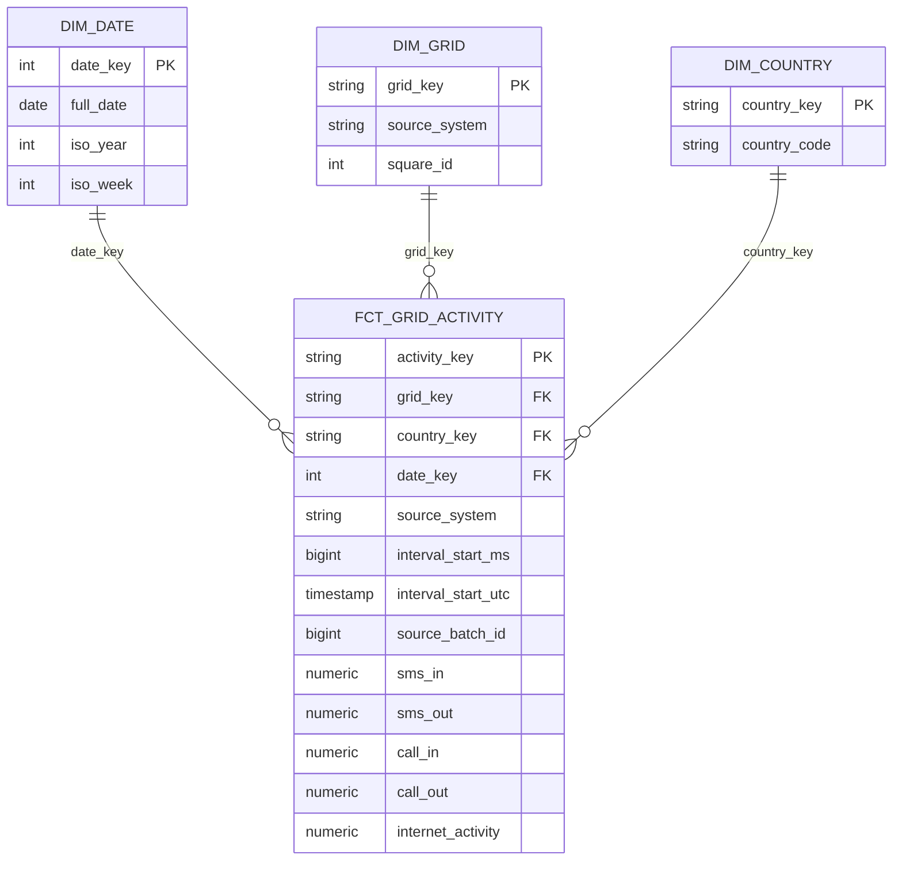

# Dimensional data model

The warehouse contains one fact and three dimensions. The fact grain is **one source system, geographic grid square, 10-minute interval, and source country code**. The models use a full rebuild in this stage; incremental processing is planned for stage 4.

`dim_grid` includes the source in its key so invented synthetic square IDs cannot be confused with real Milan squares. `dim_country` retains the source code, including `0`, without assigning an unsupported country name. `dim_date` uses **UTC**; analyses that require a Milan local day must explicitly convert to the appropriate timezone. The source measures are proportional activity values, not gigabytes or unique subscriber counts. A blank activity field becomes SQL `NULL`, not zero.

The staging view casts accepted successful raw rows and retains all versions. The intermediate view selects the highest batch ID, then highest source line number, for each fact grain. This is an explicit ingestion-order policy for replayed data, not a source update timestamp or a claim that a later load is intrinsically more accurate. The fact retains the winning batch ID and line number for traceability.

The `stable_key` macro hashes the relevant non-null source identifiers using a separator. The supported source-system identifiers and numeric key components do not contain that separator; change the encoding if future identifiers can contain it. Tests cover key uniqueness, non-null keys, relationships, non-negative measures, dimension-key correctness, raw-to-fact reconciliation, and future intervals. Slowly changing dimensions are not included because the current source does not provide changing dimension attributes.
