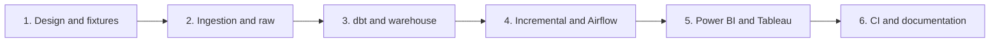

# Six-weekend implementation plan

Each future milestone is developed on its own branch and merged into `main` through a pull request after its checks pass. See the [Git workflow](git-workflow.md). Time estimate: approximately 10–15 hours per weekend; adjust the amount of data and dashboard detail to fit.

| Weekend | Work | Done when | Suggested commit |
|---|---|---|---|
| 1 | Establish scope and architecture; review source descriptions; create synthetic replay fixtures. | Repository explains the use case and data limitations; fixtures generate deterministically and tests pass. | `feat: establish project design and synthetic fixtures` |
| 2 | **Complete:** review source terms and inspect a file; configure PostgreSQL with Docker Compose; implement chunked ingestion, batch metadata, and rejects. | A checksum-verified 50,000-row source sample and synthetic batches load into raw tables, reruns are safe, and load outcomes are recorded. | `feat: ingest source batches into postgres` |
| 3 | Create dbt sources, staging models, dimensions, and a fact model; document and test keys and grain. | dbt builds a tested warehouse from loaded fixture data. | `feat: build dbt dimensional models` |
| 4 | Implement incremental updates, late-arrival replay, marts, and an Airflow DAG. | A correction changes the right fact and mart; reruns do not duplicate data; Airflow reports failures. | `feat: add incremental models and orchestration` |
| 5 | Create a Power BI report and complementary Tableau exploration using curated marts. | Both presentations show documented metrics and source provenance; screenshots are captured. | `feat: add analytics dashboards` |
| 6 | Add GitHub Actions, verify a clean setup, and finish documentation and portfolio materials. | CI catches a failing test and a new user can follow the README. | `ci: verify pipeline and document portfolio` |

Quality checks and documentation begin with the first stage and grow with the implementation. Avoid adding SCD history, streaming, or cloud services without a documented use case.

